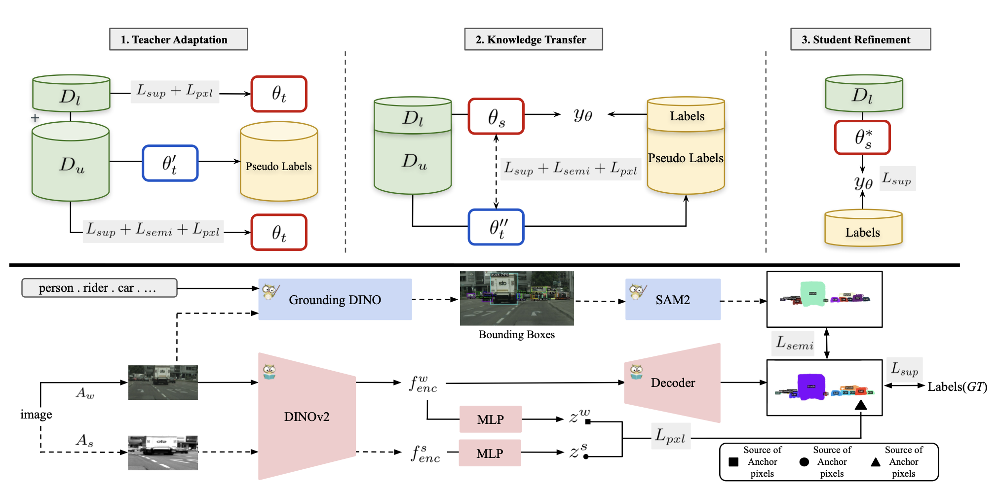
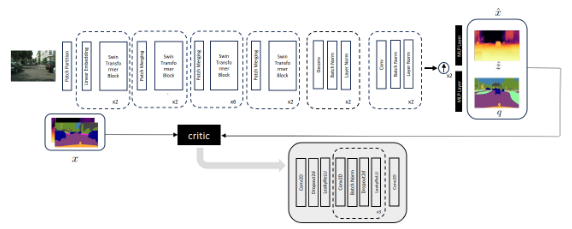
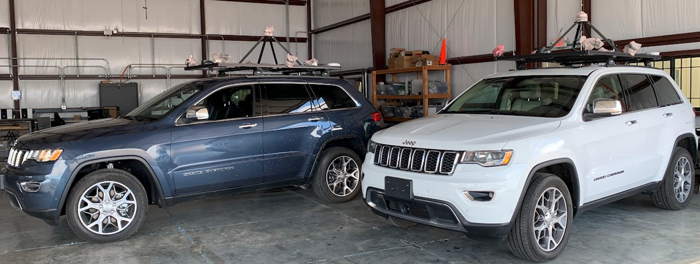

<meta name="msvalidate.01" content="8149475937CBBE15CEA9FF9F5690C937" />

# About

Hi! I am a final-year Ph.D. student at Texas A&M University, advised by Prof. Reza Langari and Prof. Zhengzhong Tu. My research centers on efficient and controllable video world models for autonomous driving. Previously, I worked with Dr. Shu Kong and Gaurav Pandey, and I received my B.S. in Mechanical Engineering from Politecnico di Torino.

  World Models
  Generative AI
  Autonomous Driving

## Featured

  

    CVPRW 2026
    
  

  

    <h3 class="content-card__title"><a href="https://pardistaghavi.github.io/cast-website/" target="_blank" rel="noopener noreferrer">CAST: Training a Student Expert via Semi-Supervised Foundation Model Distillation</a></h3>
    
Compressing vision foundation models into compact experts with limited labels.

    

      <a href="/publications/">Publications</a> ·
      <a href="https://pardistaghavi.github.io/cast-website/" target="_blank" rel="noopener noreferrer">Project page</a>
    

  

  

    IROS 2024
    
  

  

    <h3 class="content-card__title"><a href="https://arxiv.org/abs/2403.10662" target="_blank" rel="noopener noreferrer">SwinMTL: Simultaneous Depth and Semantic Segmentation</a></h3>
    
A shared multi-task architecture for monocular depth and segmentation.

    

      <a href="/publications/">Publications</a> ·
      <a href="https://github.com/PardisTaghavi/SwinMTL" target="_blank" rel="noopener noreferrer">Code</a>
    

  

  

    
  

  

    <h3 class="content-card__title"><a href="/projects/">AVA: Autonomous Vehicles for All</a></h3>
    
Led perception for diverse urban and rural autonomous driving routes.

    

      <a href="/projects/">Projects</a> ·
      <a href="https://avadataportal.web.illinois.edu/index.html" target="_blank" rel="noopener noreferrer">Website</a>
    

  

