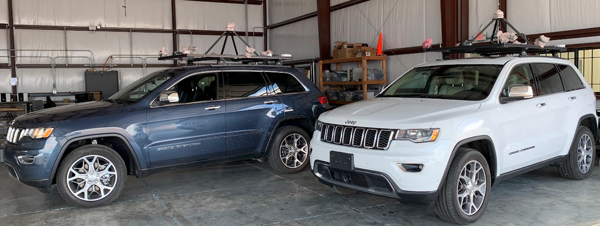
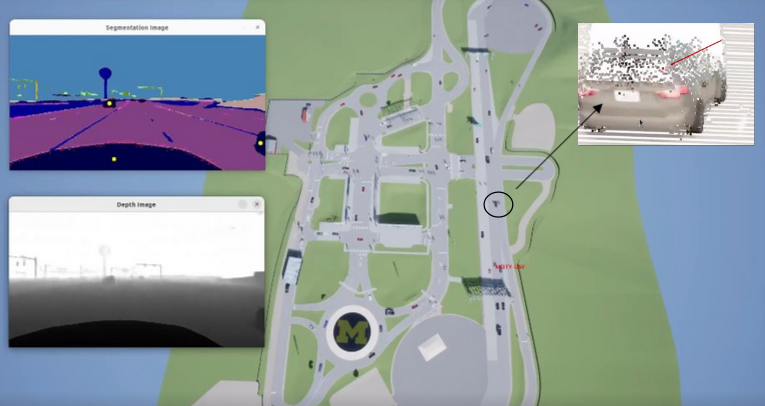

# 🚀 Projects

**AVA: Autonomous Vehicles for All**

<a href='https://avadataportal.web.illinois.edu/index.html'> website</a> 
- Lead of the Perception Team : Developed a perception system tailored for diverse route scenarios, including both urban and rural environments.

**MCITY 2.0 USE CASE AV PERCEPTION**

<a href='https://github.com/PardisTaghavi/Mcity2.0_demo'> code</a> 

- 3D point cloud generation and clustering techniques for improved object detection and scene understanding from a single RGB image.
- Validated algorithm outputs through simulation and remote operation on a real autonomous test vehicle at MCity 2.0.

