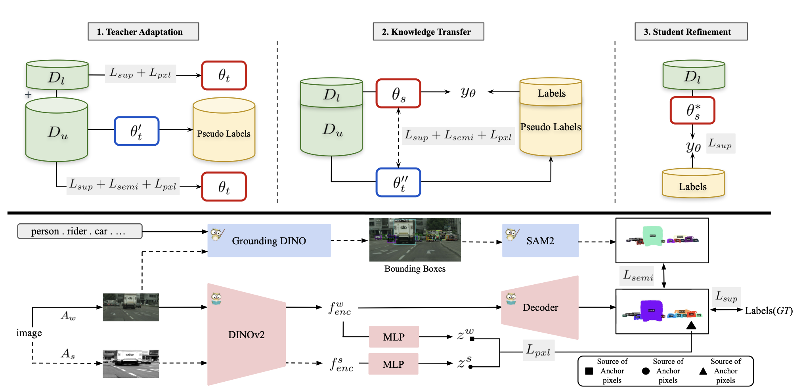
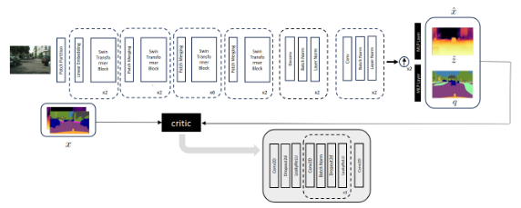
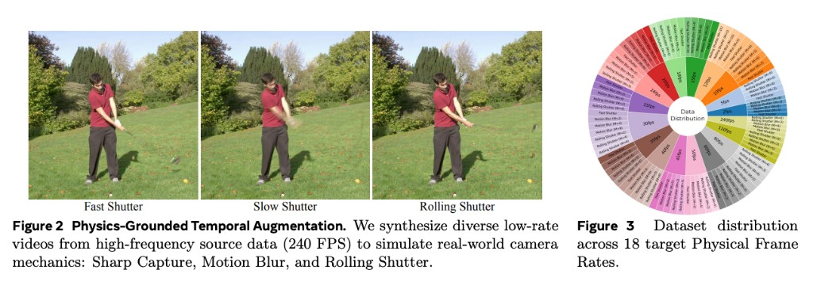
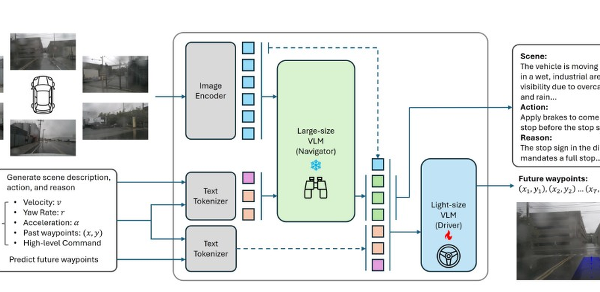

# Publications

  

    CVPRW 2026
    
  

  

    <h3 class="content-card__title"><a href="https://pardistaghavi.github.io/cast-website/" target="_blank" rel="noopener noreferrer">CAST: Training a Student Expert via Semi-Supervised Foundation Model Distillation</a></h3>
    
<strong>Pardis Taghavi</strong>, Tian Liu, Renjie Li, Reza Langari, Zhengzhong Tu

    
Semi-supervised distillation that compresses vision foundation models into compact experts using limited labeled data and abundant unlabeled data.

    

      <a href="https://openaccess.thecvf.com/content/CVPR2026W/ECV/papers/Taghavi_Training_a_Student_Expert_via_Semi-Supervised_Foundation_Model_Distillation_CVPRW_2026_paper.pdf" target="_blank" rel="noopener noreferrer">Paper</a> ·
      <a href="https://arxiv.org/abs/2604.03841" target="_blank" rel="noopener noreferrer">arXiv</a> ·
      <a href="https://pardistaghavi.github.io/cast-website/" target="_blank" rel="noopener noreferrer">Project page</a>
    

  

  

    IROS 2024
    
  

  

    <h3 class="content-card__title"><a href="https://arxiv.org/pdf/2403.10662" target="_blank" rel="noopener noreferrer">SwinMTL: A Shared Architecture for Simultaneous Depth Estimation and Semantic Segmentation</a></h3>
    
<strong>Pardis Taghavi</strong>, Reza Langari, Gaurav Pandey

    
Multi-task learning for concurrent depth estimation and semantic segmentation from a single camera.

    

      <a href="https://github.com/PardisTaghavi/SwinMTL" target="_blank" rel="noopener noreferrer">Code</a> ·
      <a href="https://arxiv.org/abs/2403.10662" target="_blank" rel="noopener noreferrer">arXiv</a>
    

  

  

    arXiv 2026
    
  

  

    <h3 class="content-card__title"><a href="https://arxiv.org/pdf/2603.14375" target="_blank" rel="noopener noreferrer">The Pulse of Motion: Measuring Physical Frame Rate from Visual Dynamics</a></h3>
    
Xiangbo Gao, Mingyang Wu, Siyuan Yang, Jiongze Yu, <strong>Pardis Taghavi</strong>, Fangzhou Lin, Zhengzhong Tu

    
Visual Chronometer recovers Physical Frames Per Second (PhyFPS) to address chronometric hallucination in generative video models.

    

      <a href="https://arxiv.org/abs/2603.14375" target="_blank" rel="noopener noreferrer">arXiv</a> ·
      <a href="https://xiangbogaobarry.github.io/Visual_Chronometer/" target="_blank" rel="noopener noreferrer">Project page</a>
    

  

  

    arXiv 2026
    
  

  

    <h3 class="content-card__title"><a href="https://arxiv.org/pdf/2603.07901" target="_blank" rel="noopener noreferrer">NaviDriveVLM: Decoupling High-Level Reasoning and Motion Planning for Autonomous Driving</a></h3>
    
Ximeng Tao, <strong>Pardis Taghavi</strong>, Dimitar Filev, Reza Langari, Gaurav Pandey

    
A Navigator–Driver framework that separates semantic reasoning from waypoint prediction for efficient end-to-end motion planning.

    

      <a href="https://arxiv.org/abs/2603.07901" target="_blank" rel="noopener noreferrer">arXiv</a>
    

  

